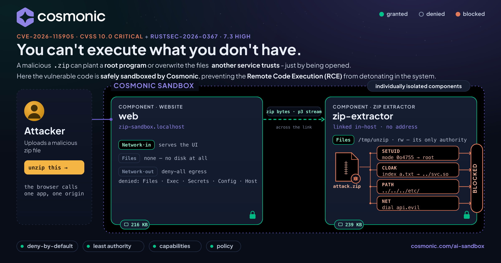

# Stopping Remote Code Execution with a Sandbox: a live zip-crate RCE demo

**Read the full story on the Cosmonic blog:** [Stopping Remote Code Execution with a Sandbox](https://cosmonic.com/blog/stopping-remote-code-execution-with-a-sandbox/)



The Rust `zip` crate shipped two serious vulnerabilities nine days apart, one of them a CVSS 10.0.
This repo runs that exact vulnerable code, unpatched, inside a deny-by-default
[Cosmonic](https://cosmonic.com/) sandbox, and lets you fire real crafted archives at it. Every
attack runs. None of them can do anything.

**Step by step:** [Sandboxed zip extractor](https://cosmonic.com/docs/desktop/examples/sandboxed-zip-extractor) (the docs walkthrough)

> **You can't execute what you don't have.** A sandbox doesn't have to recognize the attack. It
> starts with nothing and hands the code only the capabilities you grant: here, one scratch folder
> and no network. See [principles of secure agent platforms](https://cosmonic.com/ai-sandbox/principles/).

## The four attack scenarios

The demo page has one red button per scenario. Each streams a real crafted archive into the sandbox;
nothing is patched.

| Button | Vulnerability | What the crafted archive does | In the sandbox |
|---|---|---|---|
| **Bug 1: setuid bits** | [RUSTSEC-2026-0367](https://rustsec.org/advisories/RUSTSEC-2026-0367.html) · setuid · CVSS 7.3 | Three entries carry setuid, setgid and sticky bits. On a Unix extractor they'd hand a dropped file root-level powers. | All three bits reach the report; zero are applied. |
| **Bug 2: zip slip** | CWE-22 / CWE-59 · zip slip via symlinks | Three symlink entries aimed at known paths outside the folder: `/etc/cron.d`, `/root/.ssh/authorized_keys` and `/tmp`. zip 8.6.0 refuses `../` names, but on Unix its `extract()` plants these links unchecked. | All three land as plain files holding the target text; no link exists. |
| **Bug 3: zip cloaking** | [CVE-2026-115905](https://www.cve.org/CVERecord?id=CVE-2026-115905) · zip cloaking · CVSS 10.0 | The central directory shows a scanner `release-notes.txt`; the local header tells the crate's streaming extractor to write `home/you/.ssh/authorized_keys`. | The cloaked write is honored but lands inside `/tmp/unzip`, a throwaway folder. |
| **Run all attacks** | all three at once | One archive carrying every attack above. | All of the above, contained together. |

Other IDs, if you're searching for them: RUSTSEC-2026-0367 is GHSA-vv5m-jxxh-4627 (CWE-732), and
CVE-2026-115905 is GHSA-m665-v7pm-7grj (CWE-436).

Both advisories affect `zip` 8.6.0, the version used here on purpose. **In your own code, upgrade to
`zip` 9.0.5**, which fixes both.

## Quickstart

1. **Install [Cosmonic Desktop](https://cosmonic.com/desktop/).** It runs WebAssembly components as
   sandboxed workloads on macOS, Windows and Linux, and listens on `127.0.0.1:8200`.
2. **Apply the manifest.** [`deploy/zip-sandbox.workload.yaml`](deploy/zip-sandbox.workload.yaml)
   pins both components by digest on ghcr, so there's nothing to build. The easiest route is an AI
   assistant connected to Desktop's MCP server
   ([Connect coding agents](https://cosmonic.com/docs/desktop/coding-agents/)):

   > "Apply `deploy/zip-sandbox.workload.yaml` to Cosmonic Desktop, then show me its status."

   Or copy the manifest to `workloads/default/zip-sandbox.yaml` under Desktop's state directory
   (`cosmonicd paths` prints it).
3. **Open <http://zip-sandbox.localhost:8200/>** and press the red buttons, one per
   [scenario](#the-four-attack-scenarios), or upload your own zip.

> **One gotcha.** The extractor needs its `/tmp/unzip` volume. Desktop's quick-deploy paths
> (`cosmonic dev`, publish drafts, pasting an image link) build a spec from the image alone and drop
> the `volumes` section, and the extractor then answers `"sandbox unavailable"`. Apply the manifest
> as written.

### From the command line

Each scenario has an API mode and a downloadable archive, so you can inspect the raw bytes:

| Scenario | Run it | Download the archive |
|---|---|---|
| Bug 1: setuid bits | `/run?mode=suid` (the default) | `/suid.zip` |
| Bug 2: zip slip | `/run?mode=slip` | `/slip.zip` |
| Bug 3: zip cloaking | `/run?mode=cloak` | `/cloak.zip` |
| Run all attacks | `/run?mode=all` | `/all.zip` |

```bash
B=http://127.0.0.1:8200
curl -s -H 'Host: zip-sandbox.localhost' "$B/run?mode=all" | python3 -m json.tool

# or upload your own zip
curl -s -H 'Host: zip-sandbox.localhost' -H 'content-type: application/zip' \
     --data-binary @your.zip "$B/run" | python3 -m json.tool
```

A contained run of `mode=all` reports:

```
MITIGATED: 3 privileged (setuid/setgid/sticky) entries in the archive, 0 applied;
3 zip-slip symlinks neutralized; 1 cloaked entry (CVE-2026-115905) honored but confined.
Everything stayed inside /tmp/unzip.
```

## See it fail without a sandbox

[`native-demo/`](native-demo/README.md) is a small CLI that runs the same vulnerable crate directly on
macOS or Linux, with no sandbox, so you can watch the attacks succeed first. It needs a Rust toolchain.

```bash
cd native-demo
cargo run              # bug 1 (the setuid bit survives) and bug 3 (the cloaked path is written)
cargo run -- cloak     # bug 3 only
```

Bug 1 ends with `VULNERABLE: 1 file(s) kept a SUID/SGID/sticky bit after extraction`, and
`ls -l` on the extracted file shows `-rwsr-xr-x`. Bug 3 shows the scanner seeing
`release-notes.txt` while the streaming extractor writes `config/app.conf`. Same code, same kind
of archive; the only difference is what the code was handed.

## How it's built

One workload, two WebAssembly components, each its own sandbox with its own grants. `web` streams the
uploaded archive to `extractor` over a live `stream<u8>` inside the host; the browser only ever talks
to `web`.

| Component | Filesystem | Network | HTTP | Job |
|---|---|---|---|---|
| `web` | none | no egress | serves `wasi:http/handler` | UI and upload; never stores the archive |
| `extractor` | `/tmp/unzip` only (ephemeral) | no egress | none, reachable only through the link | the unzip, with the vulnerable crate |

Those grants are the whole mitigation:

- **Setuid bits have nowhere to land.** The extractor is compiled to `wasm32-wasip2`, which isn't a
  Unix target, so the crate's `#[cfg(unix)]` permission code is compiled out. The bit arrives and the
  report shows it; nothing can apply it.
- **Zip slip has nowhere to go.** The crate's symlink code is compiled out of the Wasm build, so each
  link lands as a plain file, and `/tmp/unzip` is the only path that exists inside the sandbox anyway.
- **Cloaking is contained, not fixed.** The parser differential is a crate bug and still happens in
  Wasm. But the cloaked write can only land in a throwaway, per-request folder, never on a file the host
  relies on.
- **Nothing phones home.** Both components ship `allowedHosts: []`.

The crafted archives are non-weaponized: their contents are inert text. Only the permission bits and
entry names are hostile, and no real privilege escalation is ever performed.

The same manifest runs unchanged on Kubernetes with [Cosmonic Control](https://cosmonic.com/control/),
where you can enforce these grants with admission policies. See
[Securing a cluster](https://cosmonic.com/docs/operations/securing-a-cluster/).

## Build from source (optional)

The quickstart pulls prebuilt images from ghcr
(`ghcr.io/cosmonic-labs/demo-zip-rce-sandbox/web` and `.../extractor`). To rebuild:

```bash
cd cosmonic-app/web       && cargo build --target wasm32-wasip2 --release
cd ../extractor           && cargo build --target wasm32-wasip2 --release
# publish (bump the tag, then update the digest in deploy/zip-sandbox.workload.yaml)
wash oci push ghcr.io/cosmonic-labs/demo-zip-rce-sandbox/web:<tag> \
  cosmonic-app/web/target/wasm32-wasip2/release/zip_sandbox_web.wasm
```

Cosmonic Desktop's Preflight check installs `rustc`, the `wasm32-wasip2` target and `wash` for you.

## Repo layout

```
.
├── deploy/zip-sandbox.workload.yaml   one workload, two components (ghcr images, pinned by digest)
├── cosmonic-app/
│   ├── wit/                           cosmonic:zip-demo/extraction, the stream link
│   ├── web/                           UI component: crafts and streams the archives
│   └── extractor/                     unzip component: the vulnerable crate, one folder, no network
├── native-demo/                       CLI that runs the same bugs with no sandbox (macOS, Linux)
└── docs/images/                       hero image
```

## Keep reading

[Choosing an agent sandbox](https://cosmonic.com/ai-sandbox/choosing-an-agent-sandbox/) ·
[Deny by default](https://cosmonic.com/ai-sandbox/principles/deny-by-default/) ·
[Least authority](https://cosmonic.com/ai-sandbox/least-privilege-ai-agents/) ·
[Capabilities over ambient authority](https://cosmonic.com/ai-sandbox/capabilities/)

Questions, or a case where this breaks? Find us in the [wasmCloud Slack](https://slack.wasmcloud.com/).
